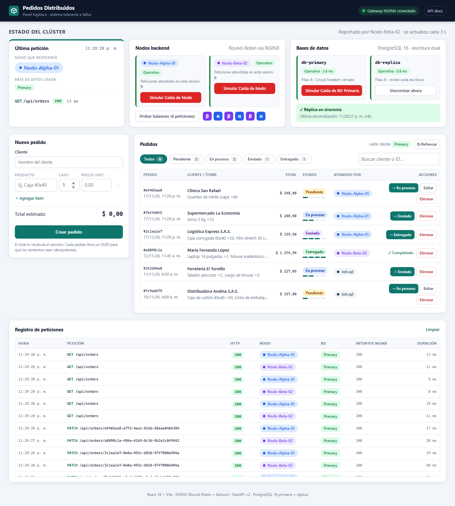
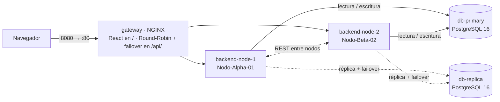

# Sistema Distribuido de Gestión de Pedidos Tolerante a Fallos

Proyecto final de Sistemas Distribuidos (`sistemas_distribuidos_2620`). Aplicación web que **crea,
lista, actualiza y elimina pedidos** y **sigue funcionando cuando falla un nodo de aplicación o la base
de datos principal**, gracias a balanceo con failover, replicación de datos y reconciliación automática.



## Arquitectura



| Mecanismo | Qué resuelve |
|-----------|--------------|
| NGINX Round-Robin + `proxy_next_upstream` | Si un nodo cae o responde 5xx, la petición se reintenta en el otro: el usuario no ve el error |
| Chaos Engineering (`SIMULATE_CRASH`) | Un nodo "caído" responde 503 en `/api/orders*` para demostrar el failover en vivo |
| Escritura dual primaria → réplica | Cada escritura queda en ambas bases |
| Failover de BD (`SIMULATE_DB_PRIMARY_DOWN` o caída real) | Si `db-primary` falla, se lee/escribe en `db-replica` y la API responde `"db_used": "replica_failover"` (nunca HTTP 500) |
| Circuit breaker + reconciliación last-write-wins | Evita esperar a una primaria caída y la pone al día cuando vuelve |
| UUID + operaciones idempotentes | Los reintentos (incluso de `POST`) no duplican pedidos |

Detalles en el [Manual Técnico](docs/01_manual_tecnico.md).

## Estructura

```text
backend/     Nodo FastAPI (Python 3.11, SQLAlchemy 2, Pydantic v2) + tests pytest
frontend/    Dashboard React 18 + Vite
nginx/       nginx.conf (upstream + failover) y Dockerfile multi-stage (build React → nginx:alpine)
database/    init.sql (tabla orders + 3 pedidos de ejemplo) y Dockerfile de PostgreSQL 16
e2e-ui/      Prueba de interfaz con Chrome headless (genera las capturas de docs/img)
docs/        01_manual_tecnico.md · 02_manual_usuario.md · 03_informe_pruebas.md · img/
.claude/     Comandos de Claude Code: /verify-cluster · /run-qa · /generate-docs
```

## Despliegue local (Docker)

Requisitos: Docker Desktop (o Docker Engine con Compose v2).

```bash
docker compose up -d --build     # construye y levanta los 5 contenedores
docker compose ps                # esperar a que los 5 estén "healthy"
```

| URL | Contenido |
|-----|-----------|
| <http://localhost:8080> | Dashboard logístico |
| <http://localhost:8080/api/docs> | Swagger de la API |
| <http://localhost:8080/api/health> | Salud del nodo que responde |

```bash
docker compose logs -f backend-node-1 backend-node-2   # trazas FAILOVER / REPLICATION / SYNC
docker compose down                                    # detener (conserva datos)
docker compose down -v                                 # detener y borrar datos (vuelve a init.sql)
```

Si el puerto 8080 está ocupado, copia `.env.example` a `.env` y cambia `GATEWAY_PORT`.

## Demostración rápida de tolerancia a fallos

Desde el dashboard: botones **Simular Caída de Nodo**, **Simular Caída de BD Primaria** y
**Probar balanceo** (ver [Manual de Usuario §6](docs/02_manual_usuario.md#6-cómo-demostrar-la-tolerancia-a-fallos)).
Desde la terminal:

```bash
BASE=http://localhost:8080
for i in 1 2 3 4; do curl -s -i $BASE/api/orders | grep -i x-handled-by-node; done   # alterna Alpha/Beta

curl -s -X POST $BASE/api/chaos/toggle/Nodo-Alpha-01                               # "tumba" Alpha
for i in 1 2 3 4; do curl -s -i $BASE/api/orders | grep -iE "^HTTP|x-handled-by-node|x-upstream-status"; done
curl -s -X POST $BASE/api/chaos/toggle/Nodo-Alpha-01                               # lo restaura

curl -s -X POST $BASE/api/chaos/db-primary/toggle                                  # "tumba" db-primary
curl -s $BASE/api/orders | grep -o '"db_used":"[a-z_]*"'                           # replica_failover
curl -s -X POST $BASE/api/chaos/db-primary/toggle                                  # restaura + reconcilia
curl -s $BASE/api/replication/status                                               # "in_sync": true

docker compose stop backend-node-1 && curl -s -o /dev/null -w '%{http_code}\n' $BASE/api/orders   # fallo real → 200
docker compose start backend-node-1
```

## API

| Método | Ruta | Descripción |
|--------|------|-------------|
| GET | `/api/health` | Salud del nodo y de ambas bases |
| GET | `/api/orders?status=&customer=` | Listar/filtrar pedidos |
| GET | `/api/orders/{id}` | Obtener un pedido |
| POST | `/api/orders` | Crear pedido `{id?, customer_name, items:[{product, quantity, unit_price}]}` |
| PATCH | `/api/orders/{id}` | Cambiar `status` (`pendiente → en proceso → enviado → entregado`) o editar |
| DELETE | `/api/orders/{id}` | Eliminar pedido |
| GET | `/api/chaos/status` | Estado del clúster (nodos, banderas, bases) |
| POST | `/api/chaos/toggle` · `/api/chaos/toggle/{nodo}` | Alternar `SIMULATE_CRASH` (nodo actual o concreto) |
| PUT | `/api/chaos/crash/{nodo}` | Fijar `SIMULATE_CRASH` con `{"enabled": bool}` |
| POST / PUT | `/api/chaos/db-primary/toggle` · `/api/chaos/db-primary` | Simular/restaurar la caída de `db-primary` (todo el clúster) |
| GET / POST | `/api/replication/status` · `/api/replication/sync` | Estado de sincronía / forzar reconciliación |

Todas las respuestas incluyen la cabecera `X-Handled-By-Node`; las de pedidos, `db_used` y
`X-DB-Used`. NGINX añade `X-Upstream-Status` (p. ej. `503, 200` cuando reintentó en el otro nodo).

## Desarrollo sin Docker

```bash
# Backend (usa SQLite local si no se definen PRIMARY_DB_URL / REPLICA_DB_URL)
cd backend
python -m venv .venv && .venv/Scripts/python -m pip install -r requirements-dev.txt   # Linux/macOS: .venv/bin/python
NODE_ID=Nodo-Alpha-01 .venv/Scripts/python -m uvicorn app.main:app --port 8000

# Frontend (proxy de /api hacia el gateway :8080 o hacia un nodo con VITE_API_PROXY)
cd frontend
npm install
VITE_API_PROXY=http://localhost:8000 npm run dev    # http://localhost:5173
```

## Pruebas

```bash
cd backend
python -m pytest -v                                                     # 15 pruebas con SQLite temporal (e2e se omiten)
TEST_PRIMARY_DB_URL=postgresql://… TEST_REPLICA_DB_URL=postgresql://… python -m pytest tests/test_orders.py   # PostgreSQL real
CLUSTER_BASE_URL=http://localhost:8080 python -m pytest tests/test_cluster_e2e.py -v                        # e2e contra el clúster

cd ../e2e-ui && npm install && node ui-test.mjs                         # interfaz con Chrome headless + capturas
```

> ⚠️ Con `TEST_*_DB_URL` las tablas se vacían en cada test: usa una base aparte (p. ej. `orders_test`).

Resultados: **15/15** (SQLite y PostgreSQL 16), **4/4** e2e, **26/26** de interfaz. Ver
[Informe de Pruebas](docs/03_informe_pruebas.md).

## Despliegue en Coolify

El `docker-compose.yml` ya es compatible: el gateway escucha en el puerto interno **80** (`expose: 80`)
y sólo publica `${GATEWAY_PORT:-8080}` en el host; las bases se construyen con `init.sql` dentro de la
imagen (sin *bind mounts*) y el archivo no usa anclas YAML.

**Antes de desplegar**

- Servidor validado en Coolify con el proxy (Traefik) en marcha y ≥ 2 GB de RAM (el build compila
  React y levanta 2 PostgreSQL + 2 nodos Python).
- Repositorio accesible: público, o privado con la **GitHub App** de Coolify autorizada para este repo.
- Dominio: registro DNS `A` hacia la IP del servidor (o usar el dominio `sslip.io` que genera Coolify).

**Pasos**

1. **Project → Environment → + New → Public Repository** (o *Private Repository (with GitHub App)*),
   rama `main`.
2. **Build Pack: Docker Compose**, *Base Directory* `/`, *Docker Compose Location* `/docker-compose.yml`.
3. **Environment Variables:**
   - `POSTGRES_PASSWORD` → contraseña fuerte (**obligatorio**: el valor por defecto está en el repo).
   - `GATEWAY_PORT` → un puerto **libre** del servidor, p. ej. `18080`. El proxy Traefik de Coolify suele
     publicar su panel en el **8080** y el despliegue fallaría con *port is already allocated*.
   - Opcionales: `POSTGRES_USER`, `POSTGRES_DB`. No definir `NODE1_SIMULATE_CRASH`/`NODE2_SIMULATE_CRASH`.
4. En el servicio **`gateway`**, asignar el dominio (p. ej. `https://pedidos.midominio.com`); Traefik
   enruta al puerto interno 80. Los demás servicios **no** llevan dominio.
5. **Deploy** y comprobar `https://<dominio>/api/health`, el dashboard y `https://<dominio>/api/docs`.
6. Validar contra el despliegue: `cd backend && CLUSTER_BASE_URL=https://<dominio> python -m pytest tests/test_cluster_e2e.py -v`.

Notas: los volúmenes `pg_primary_data` y `pg_replica_data` persisten entre despliegues (para volver a
los datos de ejemplo hay que borrarlos). El frontend usa rutas relativas `/api/...`, así que funciona
con cualquier dominio, con o sin HTTPS. Los endpoints `/api/chaos/*` son públicos (pensados para la
demostración): cualquiera con la URL puede "tumbar" un nodo.

## Comandos de Claude Code

| Comando | Qué hace |
|---------|----------|
| `/verify-cluster [puerto]` | Levanta el clúster y valida Round-Robin, caída de nodo, failover de BD y fallos reales |
| `/run-qa [--cluster]` | Ejecuta pytest y redacta `docs/03_informe_pruebas.md` con la salida real |
| `/generate-docs [tecnico\|usuario\|todo]` | Regenera los manuales a partir del código |

## Documentación

- [Manual Técnico](docs/01_manual_tecnico.md) — arquitectura, diagramas Mermaid, mecanismos de tolerancia a fallos, API
- [Manual de Usuario](docs/02_manual_usuario.md) — instalación, uso y guion de demostración con capturas
- [Informe de Pruebas](docs/03_informe_pruebas.md) — casos, salida real de pytest, pruebas de fallo y conclusiones
