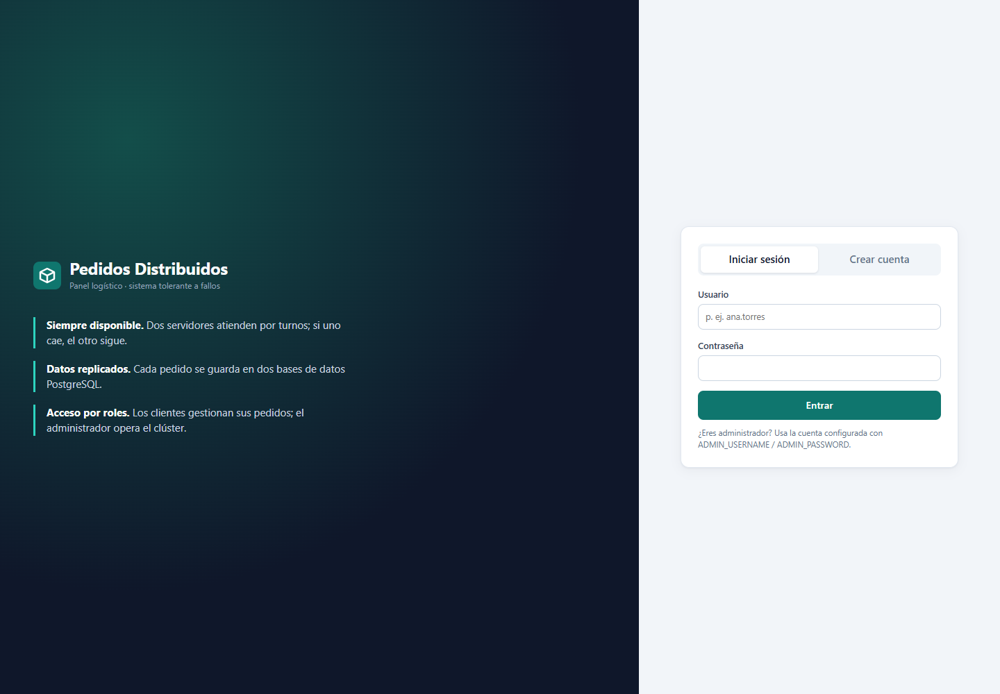
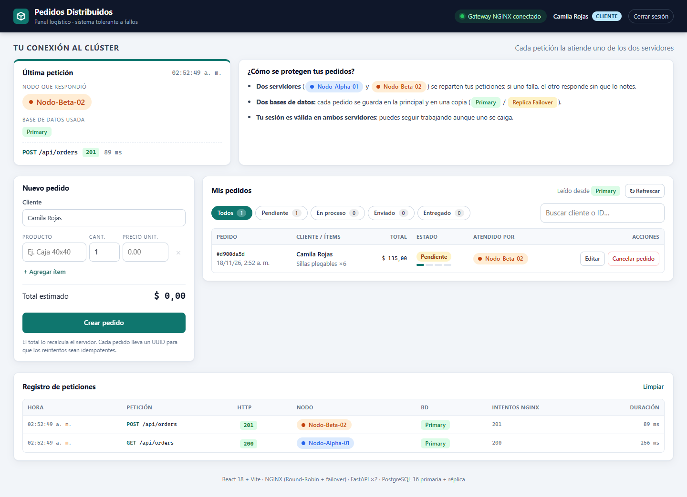
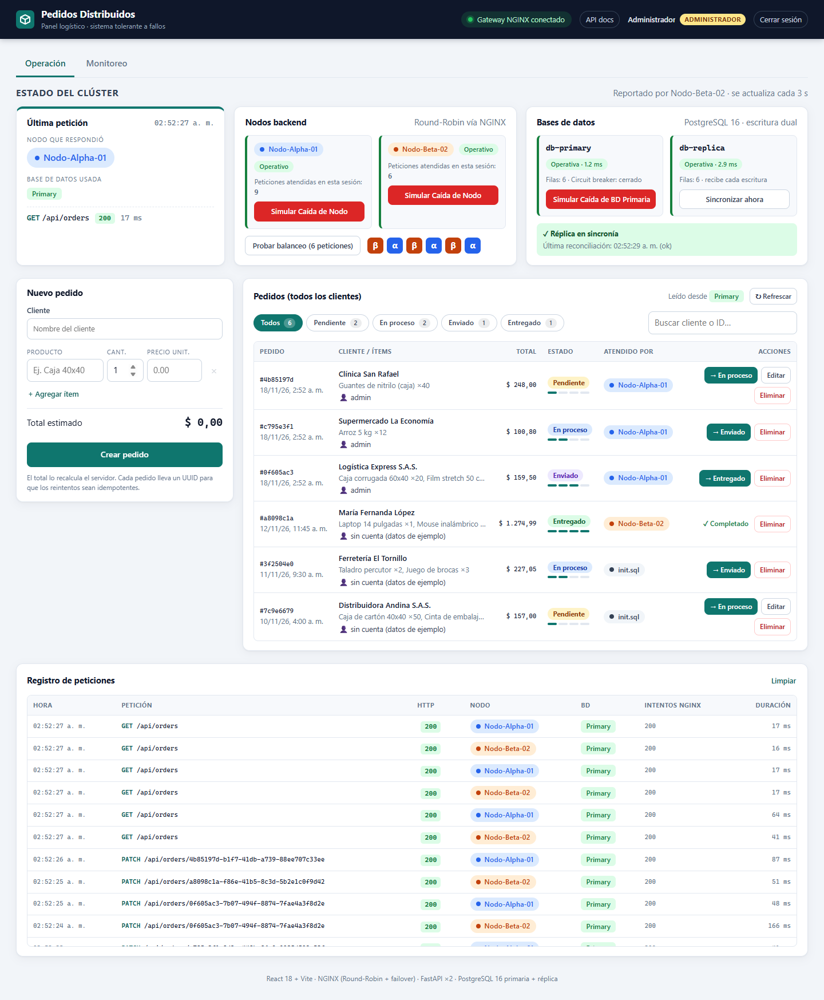
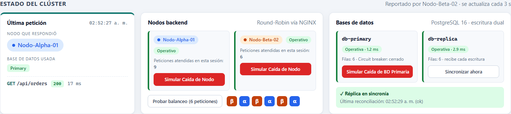
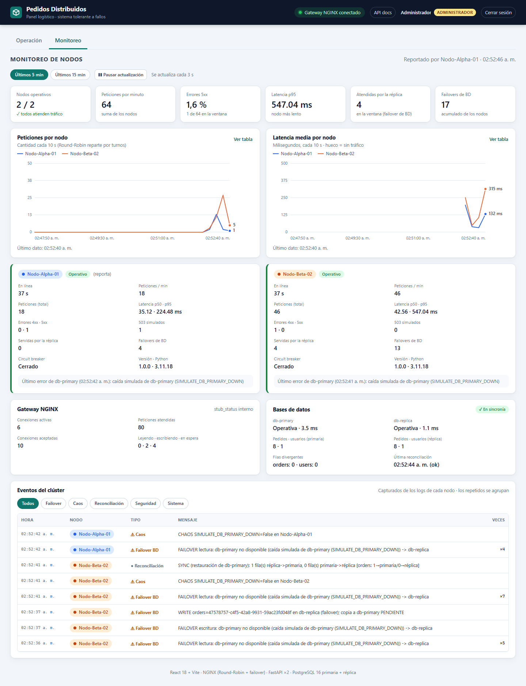
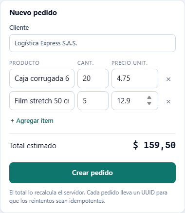
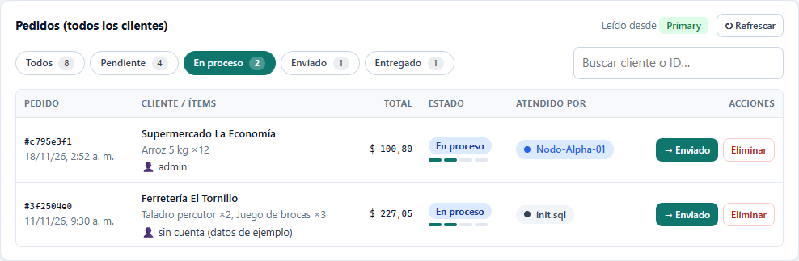

# Manual de Usuario — Sistema Distribuido de Gestión de Pedidos

> Guía para instalar, ejecutar y usar el panel logístico, y para **demostrar en vivo** la tolerancia a
> fallos. No requiere conocimientos de programación.

## Contenido

1. [¿Qué es el sistema?](#1-qué-es-el-sistema)
2. [Requisitos](#2-requisitos)
3. [Instalación y ejecución](#3-instalación-y-ejecución)
4. [Inicio de sesión y roles](#4-inicio-de-sesión-y-roles)
5. [Recorrido por la interfaz](#5-recorrido-por-la-interfaz)
6. [Gestión de pedidos](#6-gestión-de-pedidos)
7. [Cómo demostrar la tolerancia a fallos](#7-cómo-demostrar-la-tolerancia-a-fallos)
8. [Uso desde el celular](#8-uso-desde-el-celular)
9. [Preguntas frecuentes y solución de problemas](#9-preguntas-frecuentes-y-solución-de-problemas)
10. [Glosario](#10-glosario)

---

## 1. ¿Qué es el sistema?

Es una aplicación web para **registrar y dar seguimiento a pedidos** (crear, consultar, cambiar de
estado, editar y eliminar). Por dentro funciona como un sistema distribuido: hay **dos servidores**
(nodos) que atienden las peticiones y **dos bases de datos** con la misma información. Si uno de ellos
falla, el otro toma su lugar y el usuario puede seguir trabajando.

El panel muestra en todo momento **qué servidor** y **qué base de datos** atendió cada operación, y
tiene botones para **simular caídas** y comprobar que el sistema sigue funcionando.

---

## 2. Requisitos

| Requisito | Detalle |
|-----------|---------|
| Docker Desktop (Windows/macOS) o Docker Engine + Compose (Linux) | Versión con `docker compose` (v2 o superior) |
| Navegador moderno | Chrome, Edge, Firefox o Safari |
| Puerto libre | `8080` en el equipo (se puede cambiar, ver §9) |
| Memoria | ~1 GB libre para los 5 contenedores |

Opcional, sólo para desarrollo: Python 3.11 y Node.js 20+.

---

## 3. Instalación y ejecución

1. **Abrir Docker Desktop** y esperar a que indique que está en ejecución.
2. **Obtener el proyecto** (clonar el repositorio o descomprimir la carpeta entregada).
3. *(Recomendado)* Copiar `.env.example` a `.env` y elegir la contraseña del administrador
   (`ADMIN_PASSWORD`) y un secreto para las sesiones (`JWT_SECRET`). Si se omite, el sistema genera una
   contraseña de administrador aleatoria y la muestra una sola vez en los registros (ver §4.1).
4. Abrir una terminal **en la carpeta del proyecto** (donde está `docker-compose.yml`) y ejecutar:

   ```bash
   docker compose up -d --build
   ```

   La primera vez tarda unos minutos (descarga imágenes y compila el frontend).

5. Comprobar que los 5 servicios estén en estado `healthy`:

   ```bash
   docker compose ps
   ```

   ```text
   SERVICE          STATUS                    PORTS
   backend-node-1   Up 8 seconds (healthy)    8000/tcp
   backend-node-2   Up 7 seconds (healthy)    8000/tcp
   db-primary       Up 14 seconds (healthy)   5432/tcp
   db-replica       Up 14 seconds (healthy)   5432/tcp
   gateway          Up 7 seconds (healthy)    0.0.0.0:8080->80/tcp
   ```

6. Abrir **<http://localhost:8080>** en el navegador e iniciar sesión (§4).

| Dirección | Qué es |
|-----------|--------|
| <http://localhost:8080> | Panel logístico (dashboard) |
| <http://localhost:8080/api/docs> | Documentación interactiva de la API (Swagger) |
| <http://localhost:8080/api/health> | Estado del nodo que responde |

**Detener el sistema:** `docker compose down` (los datos se conservan).
**Detener y borrar todos los datos** (vuelve a los 3 pedidos de ejemplo): `docker compose down -v`.

---

## 4. Inicio de sesión y roles



Al abrir el sistema se muestra la pantalla de **Iniciar sesión / Crear cuenta**. Hay dos tipos de
usuario:

| Rol | Cómo se obtiene | Qué puede hacer |
|-----|-----------------|-----------------|
| **Cliente** | Pestaña **Crear cuenta** (usuario, nombre, contraseña) | Crear pedidos, ver **sólo los suyos**, editarlos o cancelarlos mientras estén *Pendiente* |
| **Administrador** | Cuenta inicial configurada al instalar | Ver **todos** los pedidos, cambiar estados, eliminar cualquiera, y usar el panel del clúster (simular caídas, sincronizar) |

### 4.1 Contraseña del administrador

- Si se definió `ADMIN_PASSWORD` en `.env`, el usuario es `admin` (o el de `ADMIN_USERNAME`) con esa
  contraseña.
- Si no se definió, se generó una aleatoria la primera vez. Para verla:

  ```bash
  docker compose logs backend-node-1 backend-node-2 | grep "ADMIN inicial"
  ```

- Para cambiarla o crear otro administrador:

  ```bash
  docker compose exec backend-node-1 python -m app.cli create-admin --username admin --password 'NuevaClave2026'
  ```

### 4.2 Crear una cuenta de cliente

Pulsar **Crear cuenta** y completar usuario (3–50 caracteres: letras, números, `.`, `-`, `_`), nombre
completo y contraseña (mínimo 8 caracteres, con letras y números). Al terminar se entra directamente.

### 4.3 Vista de cliente



El cliente ve **Tu conexión al clúster** (qué servidor y qué base atendieron su última petición), el
formulario de pedido (con su nombre ya puesto) y **Mis pedidos**. No ve los botones de simulación de
fallos ni los pedidos de otras personas, y no puede cambiar estados: eso lo hace el administrador.

### 4.4 Sesión y seguridad

- La barra superior muestra el nombre, el rol (**Administrador** o **Cliente**) y **Cerrar sesión**.
- La sesión dura 8 horas y **sigue funcionando aunque se caiga un servidor**.
- Tras 5 intentos fallidos de contraseña, el inicio de sesión se bloquea unos minutos.
- Si un administrador desactiva una cuenta, esa persona vuelve a la pantalla de inicio con el aviso
  *"Tu sesión terminó"*.

---

## 5. Recorrido por la interfaz

Vista del **administrador**:



La pantalla tiene cuatro zonas:

| Zona | Contenido |
|------|-----------|
| **Barra superior** | Nombre del sistema, indicador **"Gateway NGINX conectado"** (verde) o **"sin backends"** (rojo), enlace a la API (sólo admin), usuario con su rol y **Cerrar sesión** |
| **Estado del clúster** | Última petición, estado de los nodos y de las bases de datos, botones de simulación de fallos |
| **Pedidos** | Formulario "Nuevo pedido" (izquierda) y tabla de pedidos con filtros (derecha) |
| **Registro de peticiones** | Historial de las últimas peticiones con el nodo y la base que las atendió |

### 5.1 Panel "Estado del clúster"



- **Última petición:** muestra el **nodo que respondió** (`Nodo-Alpha-01` en azul o `Nodo-Beta-02` en
  naranja), la **base de datos usada** (`Primary` en verde o `Replica Failover` en ámbar), la operación,
  el código HTTP y el tiempo de respuesta. Si hubo un fallo y el sistema lo resolvió, aparece un aviso
  explicativo.
- **Nodos backend:** una tarjeta por servidor con su estado (`Operativo`, `Caída simulada (503)` o
  `Inalcanzable`), cuántas peticiones ha atendido en esta sesión y el botón **Simular Caída de Nodo**.
  El botón **Probar balanceo (6 peticiones)** envía seis consultas seguidas y muestra quién respondió
  cada una (α = Alpha, β = Beta).
- **Bases de datos:** tarjetas de `db-primary` y `db-replica` con su estado, latencia y número de filas,
  el botón **Simular Caída de BD Primaria**, el botón **Sincronizar ahora** y una franja que indica si la
  réplica está **en sincronía** con la primaria.

El panel se actualiza solo cada 3 segundos.

### 5.2 Registro de peticiones


Cada fila es una petición hecha desde la interfaz: hora, operación, código HTTP, nodo, base de datos,
**intentos NGINX** y duración. Si aparece **`503 → 200`** en rojo significa que el primer servidor falló
y el gateway reintentó automáticamente en el otro: **el usuario no vio ningún error**.

---

### 5.3 Panel de monitoreo (administrador)



La pestaña **Monitoreo** (junto a **Operación**, bajo la barra superior) muestra la salud de todo el
sistema. Se actualiza sola cada 3 segundos; **Pausar actualización** congela la vista.

| Zona | Qué muestra |
|------|-------------|
| **Rango** | Últimos 5 o 15 minutos: se aplica a todos los indicadores y gráficos |
| **Indicadores** | Nodos operativos, peticiones por minuto, % de errores 5xx, latencia p95 (nodo más lento), peticiones atendidas por la réplica y failovers de BD |
| **Gráficos** | Peticiones y latencia media de cada nodo cada 10 s (azul = Alpha, naranja = Beta). Al pasar el ratón aparece el valor de ambos nodos en ese instante; **Ver tabla** muestra los mismos datos en una tabla |
| **Tarjetas de nodo** | Estado, tiempo en línea, peticiones, latencia, errores, 503 simulados, lecturas desde la réplica, circuit breaker y último error de la BD primaria (en rojo sólo si sigue activo) |
| **Gateway NGINX** | Conexiones activas y peticiones atendidas por el balanceador |
| **Bases de datos** | Estado de cada base, filas de pedidos y usuarios, si están en sincronía y la última reconciliación |
| **Eventos del clúster** | Lo que ocurrió en cada nodo (caídas simuladas, failovers, reconciliaciones, logins fallidos…), con filtros. Los eventos repetidos se agrupan (`×9`) |

Un nodo apagado aparece como **Inalcanzable**: el resto del panel sigue funcionando.

## 6. Gestión de pedidos

### 6.1 Crear un pedido



1. Escribir el **nombre del cliente** (mínimo 2 caracteres).
2. Completar el primer ítem: **producto**, **cantidad** (entero ≥ 1) y **precio unitario** (≥ 0).
3. Para más productos, pulsar **+ Agregar ítem**; para quitar uno, pulsar **×**.
4. Revisar el **Total estimado** (el total definitivo lo calcula el servidor).
5. Pulsar **Crear pedido**. El pedido aparece al inicio de la tabla en estado **Pendiente** y una
   notificación indica qué nodo y qué base lo guardaron.

Si falta algún dato, el formulario muestra el error en rojo y no envía nada.

### 6.2 Ver, filtrar y buscar



- Los **chips de estado** (Todos, Pendiente, En proceso, Enviado, Entregado) filtran la tabla y muestran
  cuántos pedidos hay en cada estado.
- El cuadro **Buscar cliente o ID…** filtra por nombre de cliente o por el inicio del identificador.
- **Refrescar** vuelve a leer los pedidos del servidor. Junto al botón se indica de qué base se leyó.
- Cada fila muestra: identificador corto y fecha, cliente y resumen de ítems, total, estado con una barra
  de progreso de 4 pasos y el nodo que hizo el último cambio (`init.sql` para los pedidos de ejemplo).
  El administrador ve además la **cuenta dueña** del pedido (👤) y puede buscar por ella.

### 6.3 Cambiar el estado

Los pedidos avanzan siempre en este orden:

**Pendiente → En proceso → Enviado → Entregado**

*(Sólo administrador.)* Pulsar el botón verde **→ (siguiente estado)** de la fila. Cuando el pedido llega a **Entregado** se
muestra **✓ Completado**. No se puede saltar ni retroceder estados (el sistema lo impide).

### 6.4 Editar un pedido

Sólo los pedidos **Pendiente** muestran el botón **Editar** (el cliente, únicamente en los suyos). Al pulsarlo, el formulario de la izquierda
se carga con los datos del pedido; modificar lo necesario y pulsar **Guardar cambios** (o **Cancelar**).
El total se recalcula automáticamente.

### 6.5 Eliminar un pedido

El administrador ve **Eliminar** en todos los pedidos; el cliente ve **Cancelar pedido** sólo en sus
pedidos *Pendiente*. Al pulsarlo, el botón cambia a **¿Confirmar?** durante 3 segundos. Pulsarlo de nuevo para
eliminar definitivamente. Si no se confirma, vuelve a su estado normal.

---

## 7. Cómo demostrar la tolerancia a fallos

Guion sugerido para una presentación (≈ 5 minutos), con la sesión iniciada como **administrador**.

### 7.1 Balanceo de carga

1. Pulsar **Probar balanceo (6 peticiones)**.
2. **Qué observar:** la franja muestra **β α β α β α**: las peticiones se reparten por turnos entre
   los dos servidores (Round-Robin).

### 7.2 Caída de un nodo


1. En la tarjeta de **Nodo-Alpha-01**, pulsar **Simular Caída de Nodo**. La tarjeta se pone roja con
   **Caída simulada (503)**.
2. Pulsar **Probar balanceo**: ahora la franja muestra **β β β β β β**: las seis peticiones tuvieron
   éxito y todas las atendió Beta (una petición fallida aparecería como **×** en rojo).
3. Crear un pedido o avanzar un estado: **funciona normalmente** y lo atiende `Nodo-Beta-02`.
4. En el **Registro de peticiones** aparece **`503 → 200`**: el gateway detectó el fallo y reintentó
   en el otro nodo de forma transparente (ver captura de §5.2).
5. Pulsar **Restaurar nodo**. En unos segundos Alpha vuelve a recibir peticiones.

### 7.3 Caída de la base de datos primaria


1. Pulsar **Simular Caída de BD Primaria**. La tarjeta `db-primary` muestra **Caída simulada** y la
   franja de sincronía pasa a ámbar.
2. Crear un pedido. En **Última petición** la base usada es **Replica Failover** y aparece el aviso
   *"Failover de BD: db-primary no respondió; la operación se atendió en db-replica…"*.
3. La tabla indica **Leído desde Replica Failover** y sigue mostrando todos los pedidos.

### 7.4 Recuperación y reconciliación


1. Pulsar **Restaurar BD Primaria**.
2. Aparece la notificación *"db-primary restaurada · reconciliación: 1 fila(s) copiadas réplica →
   primaria"*: el pedido creado durante la caída se copió a la primaria.
3. La franja vuelve a verde: **✓ Réplica en sincronía**. Las siguientes operaciones usan **Primary**.

### 7.5 La sesión sobrevive a la caída de un servidor

Con un cliente conectado en otra ventana, simular la caída de cualquiera de los dos nodos: el cliente
sigue trabajando sin volver a iniciar sesión, porque su sesión es válida en ambos servidores.

### 7.6 Ver la demo en el panel de Monitoreo

Tras las caídas anteriores, abrir la pestaña **Monitoreo**: los gráficos muestran cómo Beta absorbió
todo el tráfico mientras Alpha estaba caído, el indicador **Atendidas por la réplica** sube durante la
caída de la BD primaria y la lista de **eventos** registra cada paso (Caos, Failover BD,
Reconciliación).

### 7.7 Fallos reales (opcional, desde la terminal)

Además de la simulación, se pueden apagar contenedores de verdad:

```bash
docker compose stop backend-node-1   # el panel marca Nodo-Alpha-01 como "Inalcanzable"; todo sigue funcionando
docker compose start backend-node-1

docker compose stop db-primary       # las operaciones pasan a "Replica Failover"
docker compose start db-primary      # en ~5-10 s la réplica y la primaria se reconcilian solas
```

---

## 8. Uso desde el celular

La interfaz se adapta a pantallas pequeñas: las tarjetas se apilan y la tabla permite desplazamiento
horizontal. La captura muestra la vista de un cliente.


---

## 9. Preguntas frecuentes y solución de problemas

| Problema | Solución |
|----------|----------|
| `docker: command not found` o *"cannot connect to the Docker daemon"* | Abrir Docker Desktop y esperar a que termine de iniciar |
| *"port is already allocated"* al levantar | Otro programa usa el 8080. Crear un archivo `.env` con `GATEWAY_PORT=8081` y abrir <http://localhost:8081> |
| La página carga pero dice **"Gateway NGINX sin backends"** | Los dos nodos están caídos. Restaurar con los botones o `docker compose start backend-node-1 backend-node-2` |
| Un pedido muestra error *"Transición inválida"* | Se intentó saltar o retroceder un estado; sólo se avanza al siguiente |
| No aparece el botón **Editar** | Sólo los pedidos en estado Pendiente se pueden editar |
| Quiero volver a los datos de ejemplo | `docker compose down -v && docker compose up -d --build` (borra también los usuarios) |
| No sé la contraseña del administrador | Ver §4.1 (registros o `python -m app.cli create-admin`) |
| *"Usuario o contraseña incorrectos"* | Revisar mayúsculas/minúsculas de la contraseña (el usuario no distingue mayúsculas) |
| *"Demasiados intentos fallidos"* | Esperar unos minutos (el tiempo exacto aparece en el mensaje) |
| *"Tu sesión terminó"* | La sesión expiró o la cuenta fue desactivada: volver a iniciar sesión |
| Un cliente no ve los botones de caída | Es lo esperado: sólo el administrador controla el clúster |
| Ver lo que hace cada servidor | `docker compose logs -f backend-node-1 backend-node-2` (busca `FAILOVER`, `REPLICATION`, `SYNC`) |
| La franja de sincronía sigue en ámbar tras restaurar | Pulsar **Sincronizar ahora** o esperar ~5 s a la reconciliación automática |

---

## 10. Glosario

| Término | Significado |
|---------|-------------|
| **Nodo** | Cada uno de los dos servidores de aplicación (`Nodo-Alpha-01`, `Nodo-Beta-02`) |
| **Gateway (NGINX)** | Puerta de entrada: entrega la página y reparte las peticiones entre los nodos |
| **Round-Robin** | Reparto por turnos: una petición a cada nodo, alternando |
| **Failover** | Cambio automático a un componente de respaldo cuando el principal falla |
| **db-primary / db-replica** | Base de datos principal y su copia de respaldo |
| **Replica Failover** | La operación se atendió desde la réplica porque la primaria no estaba disponible |
| **Reconciliación** | Proceso que iguala ambas bases copiando los cambios que faltan |
| **Caída simulada** | Fallo provocado a propósito desde el panel para demostrar la tolerancia a fallos |
| **Sesión / token** | Credencial temporal que se obtiene al iniciar sesión y que ambos servidores reconocen |
| **Rol** | Tipo de usuario: *Cliente* (sus pedidos) o *Administrador* (todo el sistema) |
